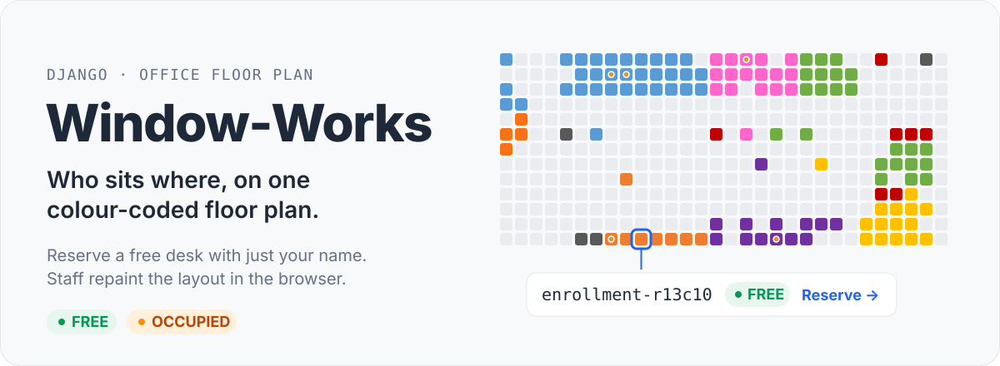
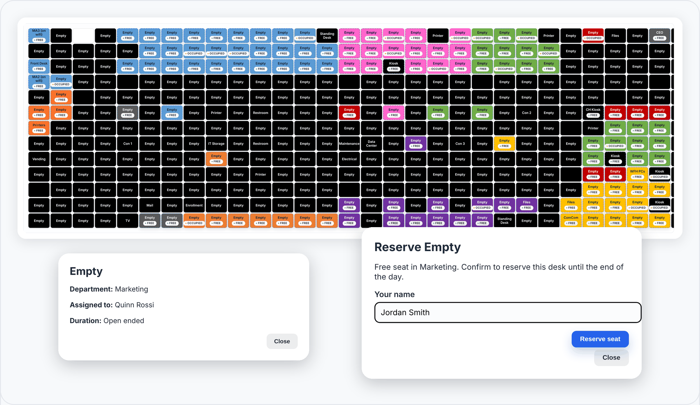
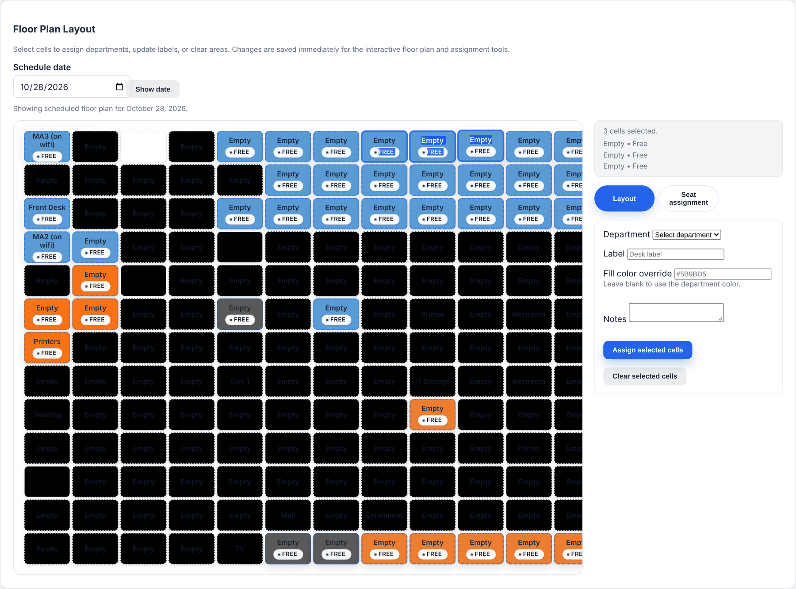

<p align="center">
  
</p>

<p align="center">
  <a href="https://github.com/miles-howell/Window-Works/actions/workflows/django.yml"></a>
  
  
</p>

Window-Works is a small Django app that turns your office into a clickable grid. Every desk is a cell, coloured by department and marked **Free** or **Occupied**. Anyone can claim a free desk by typing their name. Staff keep the map and the assignments up to date from a browser console, with no database edits.

<p align="center">
  
</p>
<p align="center"><sub>The real app running the bundled <code>floorplan_layout.json</code>, with a few demo assignments.</sub></p>

## How it works

1. **Look:** the floor plan shows every desk in a fixed grid. Colours come from departments; badges show whether a seat is free or taken. Right-click and drag to pan.
2. **Inspect:** left-click any desk to see its department, who is sitting there, and for how long.
3. **Reserve:** click a **Free** desk, enter your name, and confirm. The seat is yours until the end of the day, and any other desk booked under your name is released automatically. Your name is remembered in the browser for next time.
4. **Manage (staff):** the admin console paints departments, labels, and colours onto selected cells, and records temporary or permanent desk and work-from-home assignments.

No accounts are needed to reserve a seat. Only the admin console requires a staff login.

## Quick start

Requires Python 3.12+.

```bash
python3 -m venv venv
source venv/bin/activate
pip install -r requirements.txt

echo "SECRET_KEY=change-me-in-production" > .env

python manage.py migrate
python manage.py loaddata floorplan/fixtures/floorplan_layout.json
python manage.py runserver
```

Open <http://127.0.0.1:8000/> for the floor plan. To use the admin console at [`/admin-console/`](http://127.0.0.1:8000/admin-console/) (and the Django admin at `/admin/`), create a staff account first:

```bash
python manage.py createsuperuser
```

## Admin console

<p align="center">
  
</p>

- **Layout mode:** select one or more cells, then assign a department, label, fill colour override, or notes. You can also clear cells. Changes are saved immediately.
- **Seat assignment mode:** create desk or work-from-home assignments, temporary or permanent, with start/end times, notes, and who recorded the change.
- **Schedule date:** view the plan and the active assignments for a specific day, and end an assignment with one click.

## API endpoints

The front end is built on these JSON endpoints, which you can also use for integrations:

| Endpoint | Purpose |
| --- | --- |
| `POST /api/assignment-info/` | Latest assignment for a `name`. |
| `GET /api/desks/<identifier>/` | Desk metadata and assignment status. |
| `POST /api/desks/<identifier>/assign/` | Reserve a free desk for `assignee_name`. |
| `POST /api/layout/update/` | Staff only: layout edits and assignments. |

Desk identifiers follow the grid, for example `enrollment-r13c10` is the Enrollment desk at row 13, column 10.

## Configuration and data

- **Settings:** `workspace_manager/settings.py` loads `.env` with `python-dotenv` and reads `SECRET_KEY` from it. `DEBUG` is on and `ALLOWED_HOSTS` is limited to `localhost` / `127.0.0.1`. Change both before deploying anywhere else.
- **Storage:** SQLite by default, with WhiteNoise serving static files. Run `python manage.py collectstatic --noinput` before a production deploy.
- **Your own office:** edit the layout in the admin console, then export it with `python manage.py dumpdata floorplan --indent 2 > floorplan/fixtures/custom_floorplan.json`. Departments and their colours can be managed in the Django admin.

## Development

```bash
python manage.py test
```

CI runs the same suite on every push and pull request to `main`. The hero image is generated from the real layout fixture. Run `python assets/readme/source/build_hero.py` to redraw it after changing `floorplan_layout.json`.

## Notes

- The self-service floor plan is open by design: anyone who can reach it can reserve a seat by name.
- Placeholder or future features should use the copy "This feature is still in development." when you add new stubs.

## License

[Apache-2.0](LICENSE)
